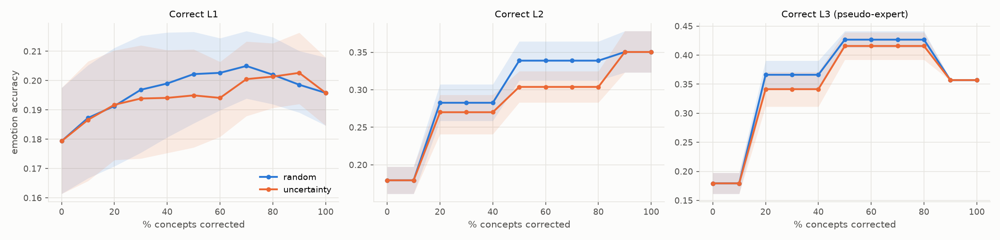
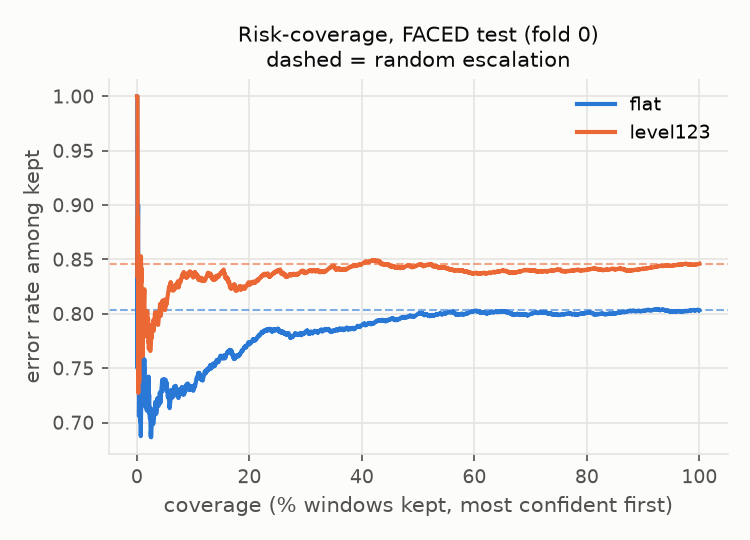

# Human-in-the-loop experiments (tag `12ch_random`, model `level123`)

> **PLACEHOLDER RUN: EEGPT weights were NOT loaded (random-init encoder).** Numbers below only show the pipeline runs end to end; they are not research results. Re-run `scripts/run_all.sh` with the real checkpoint.

## 1. Concept intervention

Emotion accuracy after correcting a fraction of one level's concepts with ground truth (L3 = **pseudo-expert**: category appraisal profiles, so correcting L3 leaks the category by construction).

### FACED test

| level | order | 0% | 30% | 50% | 70% | 100% | monotonic? |
|---|---|---|---|---|---|---|---|
| L1 | random | 0.179 | 0.197 | 0.202 | 0.205 | 0.196 | yes |
| L1 | uncertainty | 0.179 | 0.194 | 0.195 | 0.201 | 0.196 | NO |
| L2 | random | 0.179 | 0.283 | 0.339 | 0.339 | 0.350 | yes |
| L2 | uncertainty | 0.179 | 0.270 | 0.304 | 0.304 | 0.350 | yes |
| L3 | random | 0.179 | 0.366 | 0.427 | 0.427 | 0.357 | NO |
| L3 | uncertainty | 0.179 | 0.341 | 0.416 | 0.416 | 0.357 | NO |

### DREAMER (secondary labels)

| level | order | 0% | 30% | 50% | 70% | 100% | monotonic? |
|---|---|---|---|---|---|---|---|
| L1 | random | 0.181 | 0.186 | 0.186 | 0.191 | 0.180 | NO |
| L1 | uncertainty | 0.181 | 0.179 | 0.182 | 0.174 | 0.180 | NO |
| L2 | random | 0.181 | 0.245 | 0.220 | 0.220 | 0.135 | NO |
| L2 | uncertainty | 0.181 | 0.222 | 0.213 | 0.213 | 0.135 | NO |

## 2. Confidence escalation

Threshold per fold = confidence keeping 80% of that fold's FACED validation windows. Values = mean +- std over the 5 fold models. Random escalation AURC = overall error rate.

| model | set | coverage at threshold | error retained | error escalated | AURC | random AURC | ECE raw | ECE temp-scaled |
|---|---|---|---|---|---|---|---|---|
| flat | FACED val (CV) | 0.800 +- 0.000 | 0.807 +- 0.008 | 0.812 +- 0.008 | 0.803 +- 0.008 | 0.808 +- 0.007 | 0.112 +- 0.047 | 0.023 +- 0.006 |
| flat | FACED test | 0.803 +- 0.005 | 0.806 +- 0.005 | 0.822 +- 0.009 | 0.784 +- 0.005 | 0.809 +- 0.005 | 0.122 +- 0.049 | 0.023 +- 0.002 |
| flat | DREAMER (secondary) | 0.889 +- 0.009 | 0.846 +- 0.008 | 0.823 +- 0.018 | 0.854 +- 0.008 | 0.844 +- 0.008 | 0.297 +- 0.047 | 0.167 +- 0.011 |
| level123 | FACED val (CV) | 0.800 +- 0.000 | 0.811 +- 0.021 | 0.881 +- 0.011 | 0.813 +- 0.029 | 0.825 +- 0.017 | 0.133 +- 0.057 | 0.017 +- 0.005 |
| level123 | FACED test | 0.798 +- 0.010 | 0.823 +- 0.017 | 0.874 +- 0.005 | 0.815 +- 0.023 | 0.833 +- 0.013 | 0.140 +- 0.058 | 0.009 +- 0.006 |
| level123 | DREAMER (secondary) | 0.832 +- 0.022 | 0.852 +- 0.027 | 0.874 +- 0.013 | 0.868 +- 0.028 | 0.856 +- 0.022 | 0.188 +- 0.057 | 0.028 +- 0.019 |

**H5 check** (error escalated > error retained, and AURC < random):

- flat, FACED val (CV): escalated-error higher: **yes**; AURC below random: **yes**
- flat, FACED test: escalated-error higher: **yes**; AURC below random: **yes**
- flat, DREAMER (secondary): escalated-error higher: **NO**; AURC below random: **NO**
- level123, FACED val (CV): escalated-error higher: **yes**; AURC below random: **yes**
- level123, FACED test: escalated-error higher: **yes**; AURC below random: **yes**
- level123, DREAMER (secondary): escalated-error higher: **yes**; AURC below random: **NO**

