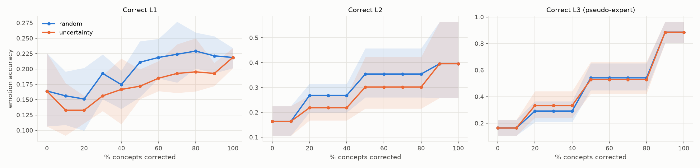
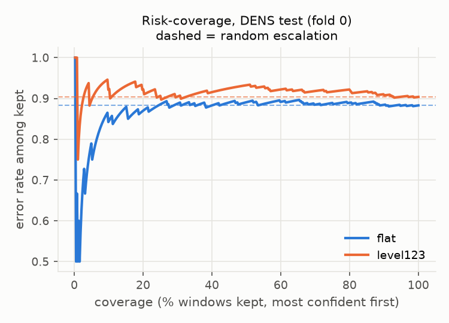

# Human-in-the-loop experiments (tag `dens12`, model `level123`)

## 1. Concept intervention

Emotion accuracy after correcting a fraction of one level's concepts with ground truth (L3 = **pseudo-expert**: category appraisal profiles, so correcting L3 leaks the category by construction).

### DENS test

| level | order | 0% | 30% | 50% | 70% | 100% | monotonic? |
|---|---|---|---|---|---|---|---|
| L1 | random | 0.164 | 0.193 | 0.211 | 0.224 | 0.219 | NO |
| L1 | uncertainty | 0.164 | 0.156 | 0.172 | 0.193 | 0.219 | NO |
| L2 | random | 0.164 | 0.268 | 0.354 | 0.354 | 0.396 | yes |
| L2 | uncertainty | 0.164 | 0.219 | 0.302 | 0.302 | 0.396 | yes |
| L3 | random | 0.164 | 0.292 | 0.542 | 0.542 | 0.885 | yes |
| L3 | uncertainty | 0.164 | 0.333 | 0.529 | 0.529 | 0.885 | yes |

### DREAMER (secondary labels)

| level | order | 0% | 30% | 50% | 70% | 100% | monotonic? |
|---|---|---|---|---|---|---|---|
| L1 | random | 0.172 | 0.184 | 0.189 | 0.197 | 0.195 | NO |
| L1 | uncertainty | 0.172 | 0.177 | 0.192 | 0.205 | 0.195 | yes |
| L2 | random | 0.172 | 0.286 | 0.400 | 0.400 | 0.435 | yes |
| L2 | uncertainty | 0.172 | 0.242 | 0.363 | 0.363 | 0.435 | yes |
| L3 | random | 0.172 | 0.346 | 0.625 | 0.625 | 0.875 | yes |
| L3 | uncertainty | 0.172 | 0.420 | 0.587 | 0.587 | 0.875 | yes |

## 2. Confidence escalation

Threshold per fold = confidence keeping 80% of that fold's DENS validation windows. Values = mean +- std over the 5 fold models. Random escalation AURC = overall error rate.

| model | set | coverage at threshold | error retained | error escalated | AURC | random AURC | ECE raw | ECE temp-scaled |
|---|---|---|---|---|---|---|---|---|
| flat | DENS val (CV) | 0.799 +- 0.001 | 0.744 +- 0.051 | 0.801 +- 0.028 | 0.704 +- 0.063 | 0.755 +- 0.036 | 0.561 +- 0.056 | 0.061 +- 0.039 |
| flat | DENS test | 0.817 +- 0.026 | 0.865 +- 0.026 | 0.818 +- 0.057 | 0.867 +- 0.016 | 0.856 +- 0.015 | 0.675 +- 0.048 | 0.152 +- 0.035 |
| flat | DREAMER (secondary) | 0.905 +- 0.015 | 0.789 +- 0.030 | 0.807 +- 0.016 | 0.791 +- 0.035 | 0.790 +- 0.029 | 0.647 +- 0.045 | 0.133 +- 0.059 |
| level123 | DENS val (CV) | 0.799 +- 0.001 | 0.779 +- 0.029 | 0.782 +- 0.039 | 0.698 +- 0.054 | 0.780 +- 0.020 | 0.447 +- 0.102 | 0.076 +- 0.039 |
| level123 | DENS test | 0.799 +- 0.083 | 0.872 +- 0.029 | 0.839 +- 0.019 | 0.877 +- 0.028 | 0.866 +- 0.025 | 0.527 +- 0.098 | 0.129 +- 0.031 |
| level123 | DREAMER (secondary) | 0.900 +- 0.010 | 0.813 +- 0.031 | 0.880 +- 0.018 | 0.743 +- 0.049 | 0.820 +- 0.028 | 0.544 +- 0.114 | 0.109 +- 0.042 |

**H5 check** (error escalated > error retained, and AURC < random):

- flat, DENS val (CV): escalated-error higher: **yes**; AURC below random: **yes**
- flat, DENS test: escalated-error higher: **NO**; AURC below random: **NO**
- flat, DREAMER (secondary): escalated-error higher: **yes**; AURC below random: **NO**
- level123, DENS val (CV): escalated-error higher: **yes**; AURC below random: **yes**
- level123, DENS test: escalated-error higher: **NO**; AURC below random: **NO**
- level123, DREAMER (secondary): escalated-error higher: **yes**; AURC below random: **yes**

