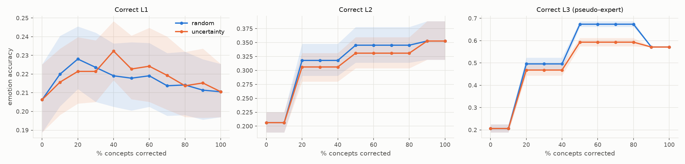
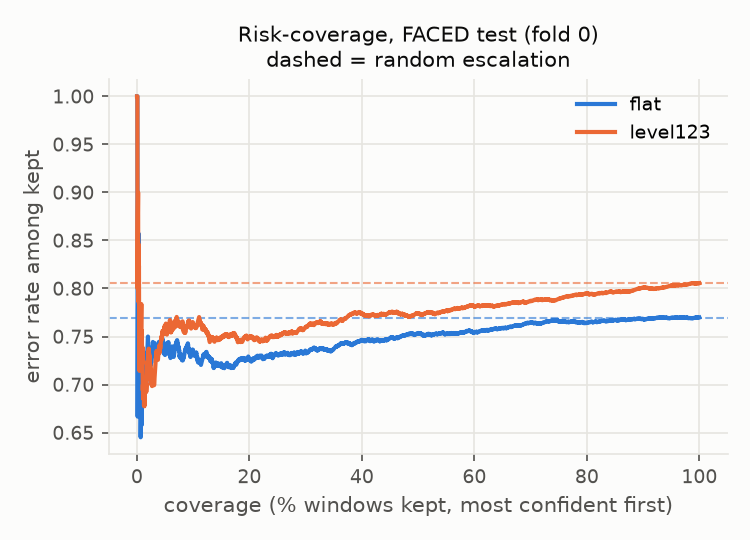

# Human-in-the-loop experiments (tag `faced12`, model `level123`)

## 1. Concept intervention

Emotion accuracy after correcting a fraction of one level's concepts with ground truth (L3 = **pseudo-expert**: category appraisal profiles, so correcting L3 leaks the category by construction).

### FACED test

| level | order | 0% | 30% | 50% | 70% | 100% | monotonic? |
|---|---|---|---|---|---|---|---|
| L1 | random | 0.206 | 0.224 | 0.218 | 0.214 | 0.211 | NO |
| L1 | uncertainty | 0.206 | 0.221 | 0.223 | 0.219 | 0.211 | NO |
| L2 | random | 0.206 | 0.318 | 0.345 | 0.345 | 0.353 | yes |
| L2 | uncertainty | 0.206 | 0.306 | 0.331 | 0.331 | 0.353 | yes |
| L3 | random | 0.206 | 0.496 | 0.674 | 0.674 | 0.571 | NO |
| L3 | uncertainty | 0.206 | 0.468 | 0.593 | 0.593 | 0.571 | NO |

### DREAMER (secondary labels)

| level | order | 0% | 30% | 50% | 70% | 100% | monotonic? |
|---|---|---|---|---|---|---|---|
| L1 | random | 0.202 | 0.199 | 0.182 | 0.181 | 0.168 | NO |
| L1 | uncertainty | 0.202 | 0.196 | 0.188 | 0.189 | 0.168 | NO |
| L2 | random | 0.202 | 0.269 | 0.266 | 0.266 | 0.265 | yes |
| L2 | uncertainty | 0.202 | 0.265 | 0.260 | 0.260 | 0.265 | NO |
| L3 | random | 0.202 | 0.515 | 0.653 | 0.653 | 0.627 | NO |
| L3 | uncertainty | 0.202 | 0.492 | 0.623 | 0.623 | 0.627 | yes |

## 2. Confidence escalation

Threshold per fold = confidence keeping 80% of that fold's FACED validation windows. Values = mean +- std over the 5 fold models. Random escalation AURC = overall error rate.

| model | set | coverage at threshold | error retained | error escalated | AURC | random AURC | ECE raw | ECE temp-scaled |
|---|---|---|---|---|---|---|---|---|
| flat | FACED val (CV) | 0.800 +- 0.000 | 0.758 +- 0.008 | 0.782 +- 0.009 | 0.745 +- 0.012 | 0.763 +- 0.008 | 0.291 +- 0.022 | 0.020 +- 0.007 |
| flat | FACED test | 0.802 +- 0.011 | 0.765 +- 0.003 | 0.788 +- 0.004 | 0.754 +- 0.003 | 0.769 +- 0.002 | 0.307 +- 0.025 | 0.021 +- 0.005 |
| flat | DREAMER (secondary) | 0.878 +- 0.020 | 0.814 +- 0.009 | 0.798 +- 0.016 | 0.828 +- 0.017 | 0.812 +- 0.009 | 0.422 +- 0.033 | 0.109 +- 0.015 |
| level123 | FACED val (CV) | 0.800 +- 0.000 | 0.780 +- 0.005 | 0.852 +- 0.018 | 0.773 +- 0.016 | 0.795 +- 0.004 | 0.330 +- 0.048 | 0.017 +- 0.006 |
| level123 | FACED test | 0.806 +- 0.009 | 0.797 +- 0.005 | 0.855 +- 0.012 | 0.785 +- 0.008 | 0.808 +- 0.005 | 0.353 +- 0.049 | 0.016 +- 0.006 |
| level123 | DREAMER (secondary) | 0.811 +- 0.036 | 0.825 +- 0.023 | 0.857 +- 0.015 | 0.847 +- 0.020 | 0.830 +- 0.020 | 0.388 +- 0.050 | 0.040 +- 0.017 |

**H5 check** (error escalated > error retained, and AURC < random):

- flat, FACED val (CV): escalated-error higher: **yes**; AURC below random: **yes**
- flat, FACED test: escalated-error higher: **yes**; AURC below random: **yes**
- flat, DREAMER (secondary): escalated-error higher: **NO**; AURC below random: **NO**
- level123, FACED val (CV): escalated-error higher: **yes**; AURC below random: **yes**
- level123, FACED test: escalated-error higher: **yes**; AURC below random: **yes**
- level123, DREAMER (secondary): escalated-error higher: **yes**; AURC below random: **NO**

