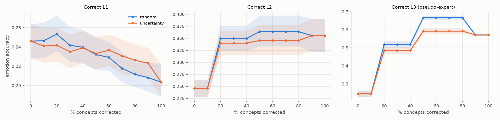
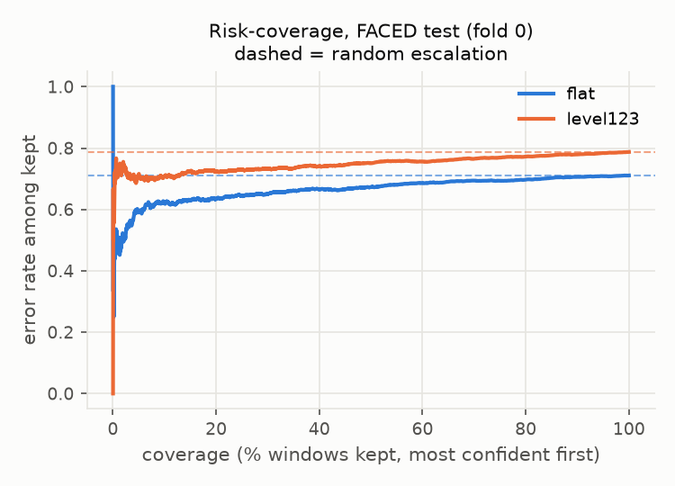

# Human-in-the-loop experiments (tag `faced30`, model `level123`)

## 1. Concept intervention

Emotion accuracy after correcting a fraction of one level's concepts with ground truth (L3 = **pseudo-expert**: category appraisal profiles, so correcting L3 leaks the category by construction).

### FACED test

| level | order | 0% | 30% | 50% | 70% | 100% | monotonic? |
|---|---|---|---|---|---|---|---|
| L1 | random | 0.246 | 0.242 | 0.232 | 0.218 | 0.204 | NO |
| L1 | uncertainty | 0.246 | 0.235 | 0.233 | 0.231 | 0.204 | NO |
| L2 | random | 0.246 | 0.350 | 0.364 | 0.364 | 0.356 | NO |
| L2 | uncertainty | 0.246 | 0.340 | 0.346 | 0.346 | 0.356 | yes |
| L3 | random | 0.246 | 0.519 | 0.667 | 0.667 | 0.571 | NO |
| L3 | uncertainty | 0.246 | 0.485 | 0.593 | 0.593 | 0.571 | NO |

### DREAMER (secondary labels)

| level | order | 0% | 30% | 50% | 70% | 100% | monotonic? |
|---|---|---|---|---|---|---|---|
| L1 | random | 0.195 | 0.194 | 0.191 | 0.184 | 0.166 | NO |
| L1 | uncertainty | 0.195 | 0.192 | 0.190 | 0.194 | 0.166 | NO |
| L2 | random | 0.195 | 0.287 | 0.281 | 0.281 | 0.247 | NO |
| L2 | uncertainty | 0.195 | 0.258 | 0.261 | 0.261 | 0.247 | NO |
| L3 | random | 0.195 | 0.508 | 0.640 | 0.640 | 0.627 | NO |
| L3 | uncertainty | 0.195 | 0.436 | 0.539 | 0.539 | 0.627 | yes |

## 2. Confidence escalation

Threshold per fold = confidence keeping 80% of that fold's FACED validation windows. Values = mean +- std over the 5 fold models. Random escalation AURC = overall error rate.

| model | set | coverage at threshold | error retained | error escalated | AURC | random AURC | ECE raw | ECE temp-scaled |
|---|---|---|---|---|---|---|---|---|
| flat | FACED val (CV) | 0.800 +- 0.000 | 0.709 +- 0.007 | 0.759 +- 0.022 | 0.685 +- 0.010 | 0.719 +- 0.008 | 0.322 +- 0.040 | 0.024 +- 0.009 |
| flat | FACED test | 0.796 +- 0.013 | 0.712 +- 0.009 | 0.775 +- 0.007 | 0.687 +- 0.012 | 0.725 +- 0.008 | 0.327 +- 0.034 | 0.021 +- 0.006 |
| flat | DREAMER (secondary) | 0.842 +- 0.022 | 0.792 +- 0.009 | 0.813 +- 0.017 | 0.785 +- 0.009 | 0.796 +- 0.011 | 0.436 +- 0.037 | 0.094 +- 0.013 |
| level123 | FACED val (CV) | 0.800 +- 0.000 | 0.760 +- 0.008 | 0.844 +- 0.010 | 0.729 +- 0.014 | 0.777 +- 0.007 | 0.376 +- 0.035 | 0.022 +- 0.012 |
| level123 | FACED test | 0.796 +- 0.006 | 0.767 +- 0.006 | 0.849 +- 0.014 | 0.738 +- 0.006 | 0.784 +- 0.006 | 0.381 +- 0.033 | 0.018 +- 0.005 |
| level123 | DREAMER (secondary) | 0.789 +- 0.016 | 0.821 +- 0.004 | 0.853 +- 0.018 | 0.839 +- 0.004 | 0.828 +- 0.004 | 0.429 +- 0.038 | 0.052 +- 0.005 |

**H5 check** (error escalated > error retained, and AURC < random):

- flat, FACED val (CV): escalated-error higher: **yes**; AURC below random: **yes**
- flat, FACED test: escalated-error higher: **yes**; AURC below random: **yes**
- flat, DREAMER (secondary): escalated-error higher: **yes**; AURC below random: **yes**
- level123, FACED val (CV): escalated-error higher: **yes**; AURC below random: **yes**
- level123, FACED test: escalated-error higher: **yes**; AURC below random: **yes**
- level123, DREAMER (secondary): escalated-error higher: **yes**; AURC below random: **NO**

