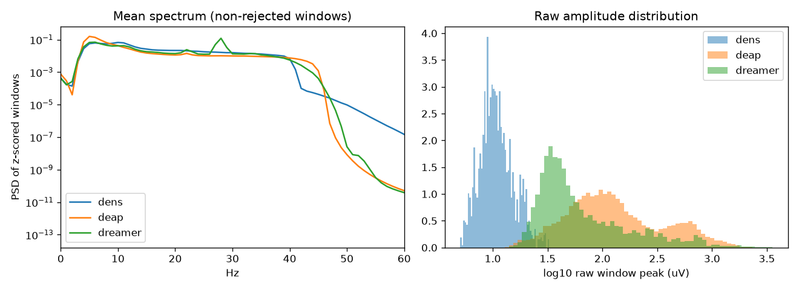

# Cross-dataset QC (Phase 2.8)

Generated by `scripts/qc_cross_dataset.py` from `data/processed/*/windows_12ch.h5`.

## Counts and rejection

| dataset | subjects | windows | rejected | rejected % | windows/subject (min-max) | samples | channels |
|---|---|---|---|---|---|---|---|
| dens | 40 | 1900 | 0 | 0.00 | 16-128 | 1024 | 12 |
| deap | 32 | 19200 | 67 | 0.35 | 600-600 | 1024 | 12 |
| dreamer | 23 | 6210 | 393 | 6.33 | 270-270 | 1024 | 12 |

Expected window counts: DENS 475 click-locked epochs x 4 = 1,900 (40 subjects); FACED 119 subjects x 28 clips x 7 = 23,324 (4 subjects excluded, D1); DEAP 32 x 40 x 15 = 19,200; DREAMER 23 x 18 x 15 = 6,210.

## Per-subject noise flags (raw window peak, uV, before z-score)

Subject median peak and rejection rate; subjects flagged if rejection > 20% or median peak > 300 uV. **Flagged subjects are kept (no post-hoc exclusion on the zero-shot corpora); they are reported for sensitivity analyses.**

| dataset | subject | median peak uV | rejected % | flag |
|---|---|---|---|---|
| deap | s02 | 479 | 0.0 | FLAG |
| deap | s04 | 332 | 0.0 | FLAG |
| deap | s09 | 429 | 0.0 | FLAG |
| deap | s11 | 858 | 0.0 | FLAG |
| deap | s17 | 614 | 0.0 | FLAG |
| deap | s22 | 840 | 0.0 | FLAG |
| deap | s24 | 617 | 0.0 | FLAG |
| deap | s25 | 331 | 0.2 | FLAG |
| dreamer | d15 | 36 | 25.2 | FLAG |
| dreamer | d20 | 465 | 0.0 | FLAG |
| dreamer | d21 | 41 | 22.6 | FLAG |

Flagged subjects: dens 0/40, deap 8/32, dreamer 3/23

## Band-power distribution after z-scoring (log power, mean over channels, mean +- std over windows)

| dataset | theta | alpha | gamma |
|---|---|---|---|
| dens | -3.05 +- 0.28 | -2.96 +- 0.39 | -4.47 +- 0.42 |
| deap | -2.76 +- 0.98 | -3.44 +- 0.69 | -5.32 +- 0.96 |
| dreamer | -3.79 +- 1.65 | -4.07 +- 1.73 | -5.27 +- 1.46 |

## Domain-shift check

Logistic regression on 36 log band-power features (12 ch x theta/alpha/gamma) predicting the dataset of origin, balanced (<=4000 windows/dataset), subject-wise 5-fold CV. Chance = 0.333. **Accuracy = 0.680 +- 0.052** (folds: 0.739, 0.661, 0.614, 0.643, 0.743).
A value far above chance means the corpora are separable from band power alone (strong dataset shift); the paper must discuss this as a limitation of zero-shot cross-corpus transfer.

## Label distributions

DENS coarse window counts: happy 520, surprise 248, fear 200, disgust 260, anger 248, sadness 424
DENS valence>5: 30.1% ; arousal>5: 77.1% ; dominance>5: 51.2% (ties at 5: V 0.8%)
DENS epochs per subject: mit003 7, mit004 8, mit007 7, mit014 16, mit017 7, mit022 24, mit023 7, mit024 8, mit032 10, mit035 27, mit039 6, mit040 5, mit051 13, mit052 28, mit054 5, mit061 9, mit067 7, mit072 32, mit074 19, mit076 4, mit079 23, mit080 6, mit081 4, mit082 23, mit096 5, mit097 8, mit099 21, mit104 5, mit106 9, mit107 5, mit108 8, mit111 11, mit113 6, mit114 24, mit116 12, mit117 6, mit121 15, mit122 18, mit123 10, mitb2017007 7
DEAP quadrants (LVLA, LVHA, HVLA, HVHA, tie): 3900, 4410, 3825, 6585, 480
DEAP valence>5: 55.3% ; arousal>5: 57.6%
DREAMER valence>3: 39.4% (=3: 21.7%); arousal>3: 43.7% (=3: 28.7%)
