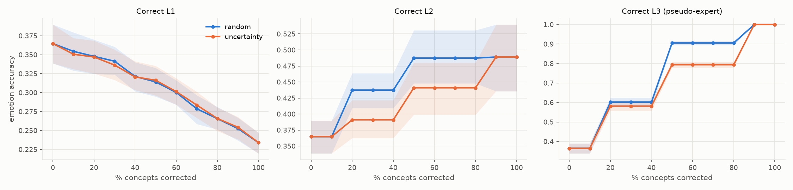
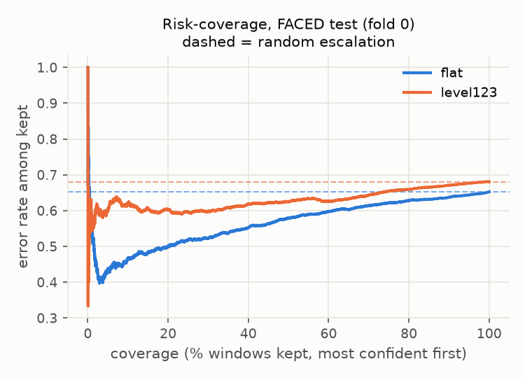

# Human-in-the-loop experiments (tag `repro_faced30sx`, model `level123`)

## 1. Concept intervention

Emotion accuracy after correcting a fraction of one level's concepts with ground truth (L3 = **pseudo-expert**: category appraisal profiles, so correcting L3 leaks the category by construction).

### FACED test

| level | order | 0% | 30% | 50% | 70% | 100% | monotonic? |
|---|---|---|---|---|---|---|---|
| L1 | random | 0.365 | 0.341 | 0.314 | 0.279 | 0.234 | NO |
| L1 | uncertainty | 0.365 | 0.336 | 0.316 | 0.284 | 0.234 | NO |
| L2 | random | 0.365 | 0.437 | 0.487 | 0.487 | 0.489 | yes |
| L2 | uncertainty | 0.365 | 0.391 | 0.441 | 0.441 | 0.489 | yes |
| L3 | random | 0.365 | 0.602 | 0.905 | 0.905 | 1.000 | yes |
| L3 | uncertainty | 0.365 | 0.581 | 0.794 | 0.794 | 1.000 | yes |

### DREAMER (secondary labels)

| level | order | 0% | 30% | 50% | 70% | 100% | monotonic? |
|---|---|---|---|---|---|---|---|
| L1 | random | 0.245 | 0.241 | 0.225 | 0.213 | 0.204 | NO |
| L1 | uncertainty | 0.245 | 0.248 | 0.231 | 0.222 | 0.204 | NO |
| L2 | random | 0.245 | 0.329 | 0.382 | 0.382 | 0.401 | yes |
| L2 | uncertainty | 0.245 | 0.273 | 0.310 | 0.310 | 0.401 | yes |
| L3 | random | 0.245 | 0.493 | 0.862 | 0.862 | 1.000 | yes |
| L3 | uncertainty | 0.245 | 0.441 | 0.694 | 0.694 | 1.000 | yes |

## 2. Confidence escalation

Threshold per fold = confidence keeping 80% of that fold's FACED validation windows. Values = mean +- std over the 5 fold models. Random escalation AURC = overall error rate.

| model | set | coverage at threshold | error retained | error escalated | AURC | random AURC | ECE raw | ECE temp-scaled |
|---|---|---|---|---|---|---|---|---|
| flat | FACED val (CV) | 0.800 +- 0.000 | 0.608 +- 0.007 | 0.732 +- 0.018 | 0.554 +- 0.005 | 0.633 +- 0.006 | 0.425 +- 0.017 | 0.033 +- 0.010 |
| flat | FACED test | 0.809 +- 0.008 | 0.630 +- 0.010 | 0.738 +- 0.017 | 0.568 +- 0.011 | 0.651 +- 0.009 | 0.443 +- 0.020 | 0.021 +- 0.007 |
| flat | DREAMER (secondary) | 0.825 +- 0.007 | 0.768 +- 0.014 | 0.785 +- 0.017 | 0.753 +- 0.018 | 0.771 +- 0.014 | 0.580 +- 0.012 | 0.130 +- 0.022 |
| level123 | FACED val (CV) | 0.800 +- 0.000 | 0.640 +- 0.007 | 0.773 +- 0.008 | 0.607 +- 0.016 | 0.666 +- 0.005 | 0.534 +- 0.020 | 0.050 +- 0.007 |
| level123 | FACED test | 0.800 +- 0.011 | 0.661 +- 0.005 | 0.793 +- 0.021 | 0.629 +- 0.019 | 0.688 +- 0.004 | 0.555 +- 0.017 | 0.031 +- 0.008 |
| level123 | DREAMER (secondary) | 0.799 +- 0.017 | 0.772 +- 0.010 | 0.822 +- 0.008 | 0.774 +- 0.023 | 0.782 +- 0.008 | 0.648 +- 0.018 | 0.072 +- 0.007 |

**H5 check** (error escalated > error retained, and AURC < random):

- flat, FACED val (CV): escalated-error higher: **yes**; AURC below random: **yes**
- flat, FACED test: escalated-error higher: **yes**; AURC below random: **yes**
- flat, DREAMER (secondary): escalated-error higher: **yes**; AURC below random: **yes**
- level123, FACED val (CV): escalated-error higher: **yes**; AURC below random: **yes**
- level123, FACED test: escalated-error higher: **yes**; AURC below random: **yes**
- level123, DREAMER (secondary): escalated-error higher: **yes**; AURC below random: **yes**

